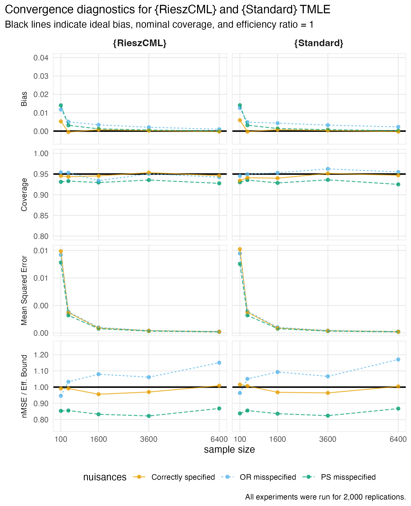
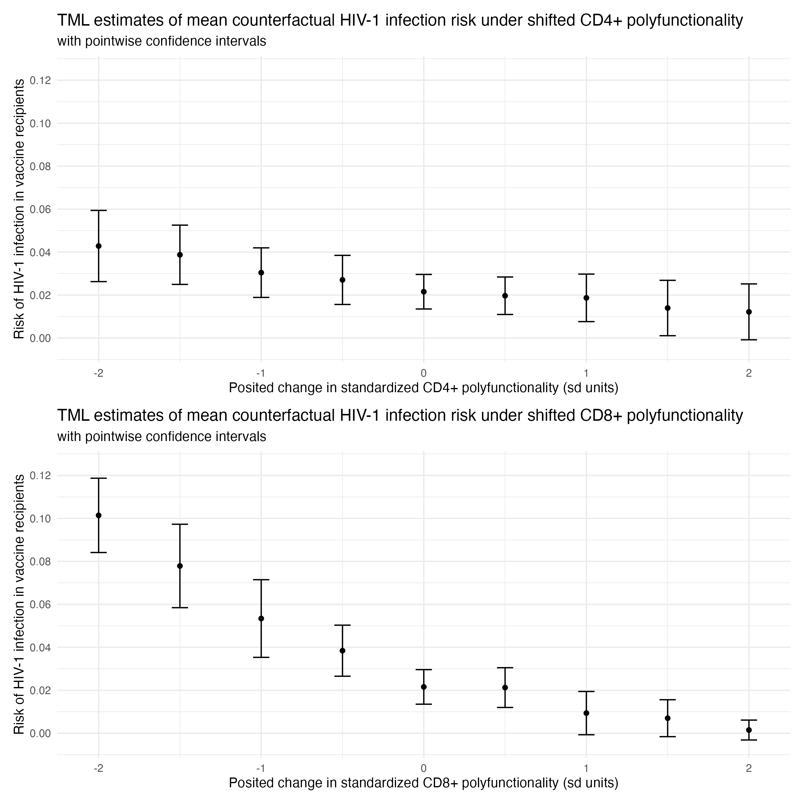
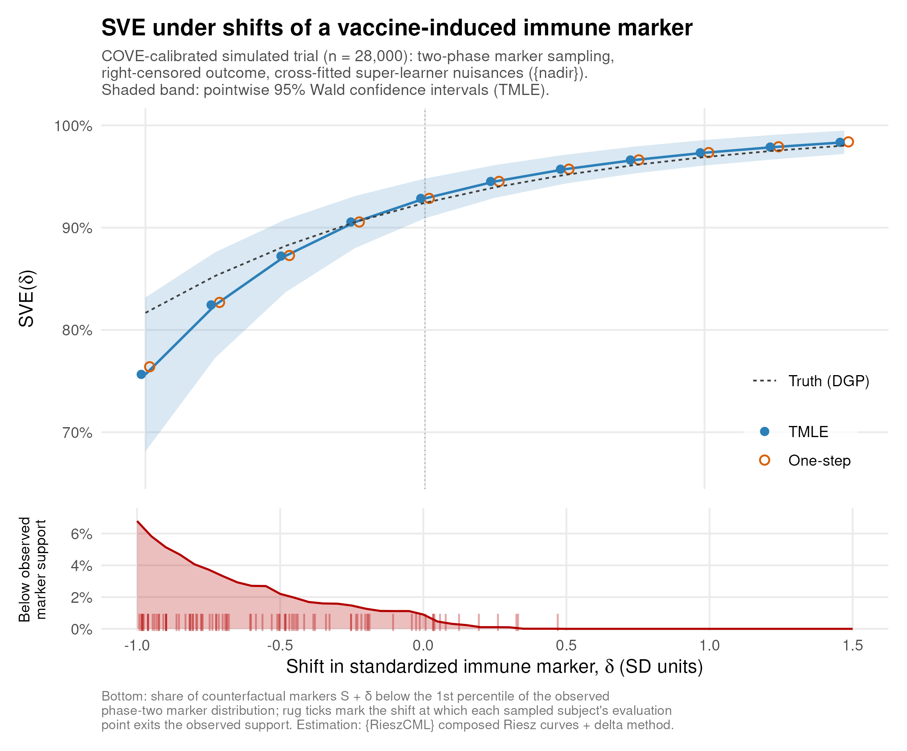

# RieszCML Simulation Studies 

This repository contains full reproduction code for the analyses 
reported on in the manuscript *A Riesz Representer Perspective on Targeted Learning*.

The code is organized according around three analyses: 

  1. Comparison of `{RieszCML}` to standard practices using existing
  software `{tmle3}`
  2. An analysis using data from the HVTN 505 trial 
  3. An analysis using simulated data calibrated to the COVE trial, 
  to illustrate constructing the stochastic vaccine efficacy parameter
  as two `ComposedRieszCurve` objects and using `riesz_delta()`. 
  
## Comparison of Methods

In the `comparison_of_methods/` directory we provide code for 
benchmarking the performance of `RieszCML` against `tmle3` to show
that our software replicates the performance of existing standard
practices.



## HVTN 505 Analysis

Our manuscript takes the perspective that 
our theory and software applies generally to *compositions* of nested
expectations of nuisance parameters at each stage. In order to illustrate
the utility of this approach, we analyze the HVTN 505 
trial data as an example application.



## SVE COVE

The prior analyses show how we can estimate risks within 
each arm of a study, which is a simpler application of the RieszCML 
package and framework.  To take this one step further, we illustrate 
construction of the stochastic vaccine efficacy parameter 
(as well as estimation and inference for it) using synthetic data 
generated to mimic the COVE trial results. 



## Workflow 

After cloning this repository, users can replicate the `data-analysis/` results
quite easily on a personal computer. However, the results for `comparison_of_methods/` and
`sve_cove_cluster/` were designed to be run on a research computing cluster running 
the [SLURM workload manager](https://slurm.schedmd.com/overview.html).

Before any replication code can be effectively run, users need to make sure
they have `renv` installed, and that they run `renv::status()` and `renv::restore()` 
to make sure they have exactly the same package versions of all dependency
packages installed. 

In order to run the analysis code: 

  * `data-analysis/`

To reproduce the analysis of the HVTN 505 data, after having cloned this repository
and used `renv::restore()`, run 

```r
rmarkdown::render("data-analysis/analyzing-vaccine-manual.Rmd")
```

  * `comparison_of_methods/`

On a research computing cluster running SLURM, from the top level of this 
repo, run: 

```sh
# this launches a job array 1-100 checking out 24GB of memory and 10 CPUs for 
# each job
sbatch comparison_of_methods/slurm/slurm_run_experiment.sh
```

  * `sve_cove_cluster/`: 

```sh
# run the monte carlo jobs first:
# this launches a job array 1-1000 checking out 6GB of memory and 1 CPU for
# each job
sbatch sve_cove_cluster/sbatch_sve_cove_mc_array.sh

# after the above finishes, process the results
sbatch sve_cove_cluster/sbatch_sve_cove_primary.sh
```


```r
> sessionInfo()
R version 4.5.3 (2026-03-11)
Platform: x86_64-pc-linux-gnu
Running under: Rocky Linux 8.10 (Green Obsidian)

Matrix products: default
BLAS:   /n/sw/helmod-rocky8/apps/Core/R/4.5.3-fasrc01/lib64/R/lib/libRblas.so
LAPACK: /n/sw/helmod-rocky8/apps/Core/R/4.5.3-fasrc01/lib64/R/lib/libRlapack.so;  LAPACK version 3.12.1

locale:
 [1] LC_CTYPE=en_US.UTF-8       LC_NUMERIC=C
 [3] LC_TIME=en_US.UTF-8        LC_COLLATE=en_US.UTF-8
 [5] LC_MONETARY=en_US.UTF-8    LC_MESSAGES=en_US.UTF-8
 [7] LC_PAPER=en_US.UTF-8       LC_NAME=C
 [9] LC_ADDRESS=C               LC_TELEPHONE=C
[11] LC_MEASUREMENT=en_US.UTF-8 LC_IDENTIFICATION=C

time zone: America/New_York
tzcode source: system (glibc)

attached base packages:
[1] stats     graphics  grDevices datasets  utils     methods   base

loaded via a namespace (and not attached):
[1] compiler_4.5.3 tools_4.5.3    yaml_2.3.10    renv_1.1.5
```
